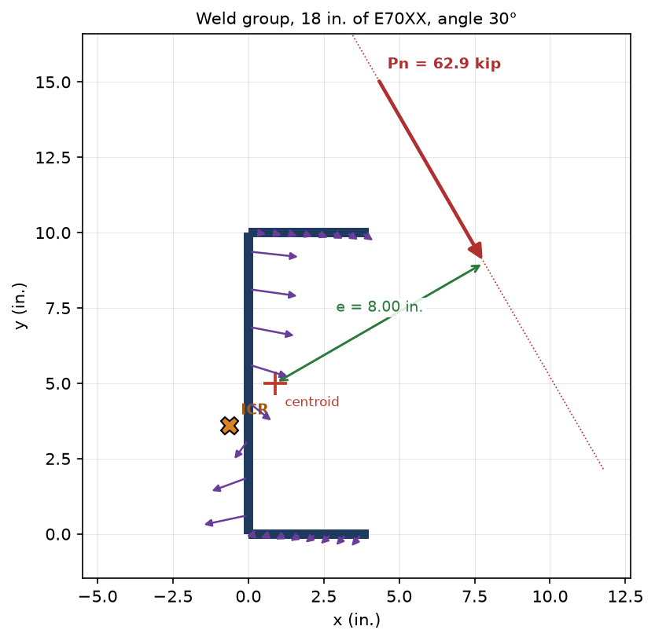

# Welds and weld groups

The {mod}`steel_design.welds` package implements AISC 360-22 Section J2 (LRFD) for fillet welds
and the instantaneous center of rotation (ICR) method of the Steel Construction Manual, Part 8,
for fillet weld groups loaded in the plane of the group.

## Electrodes

Filler metals are classes with single values, like the steel and bolt grades (Table J2.5).

| Class | `FEXX` | `Fnw = 0.60 FEXX` | `C1` (Table 8-3) |
| ----- | ------ | ----------------- | ---------------- |
| `E60XX` | 60 ksi | 36 ksi | 0.857 |
| `E70XX` | 70 ksi | 42 ksi | 1.00 |
| `E80XX` | 80 ksi | 48 ksi | 1.14 |
| `E90XX` | 90 ksi | 54 ksi | 1.29 |
| `E100XX` | 100 ksi | 60 ksi | 1.43 |
| `E110XX` | 110 ksi | 66 ksi | 1.57 |

`E70XX.Fnw()` and `E70XX.C1()` return the values. `C1` is computed as `FEXX / 70`.

## A single fillet weld

```python
from steel_design import Q_
from steel_design.welds import E70XX, FilletWeld, min_fillet_size, max_fillet_size

weld = FilletWeld(Q_(5 / 16, "in"), Q_(10, "in"), electrode=E70XX, angle=0)
weld.throat                   # 0.707 w, Section J2.2a
weld.strength()               # WeldStrength: Rn, phi, reference (Eq. J2-4)
weld.design_strength()        # phi Rn = 69.6 kip
min_fillet_size(Q_(0.75, "in"))   # Table J2.4
max_fillet_size(Q_(0.5, "in"))    # Section J2.2b(b)
```

`Rn = Fnw Awe kds` (Eq. J2-4) with `phi = 0.75`. The directional strength increase
`kds = 1 + 0.5 sin^1.5(theta)` is applied only when `directional=True`, because it is permitted
only when strain compatibility is considered. The effective length of a long end-loaded weld is
reduced per Section J2.2b(d). `minimum_length()` returns four times the weld size.

## Weld groups

```python
from steel_design.welds import WeldGroup, WeldLine

group = WeldGroup.c_shape(height=Q_(10, "in"), flange=Q_(4, "in"), size=Q_(5 / 16, "in"))
group = WeldGroup.box(width, height, size)
group = WeldGroup.parallel_vertical(length, spacing, size)       # also parallel_horizontal
group = WeldGroup.l_shape(height, flange, size, flange_at="bottom")
group = WeldGroup.line(length, size)
group = WeldGroup([WeldLine((x1, y1), (x2, y2), size), ...])     # any arrangement of lines
```

Coordinates have x to the right and y up; every length is a pint quantity. `centroid`, `Ip` and
`total_length` describe the layout. Lines of different leg sizes are allowed: the centroid is
weighted by the throat area. Each constructor accepts `electrode=` and `n_elements=` (the number of
elements each line is divided into for the ICR analysis, 40 by default).

Only the weld metal strength is checked, with `phi = 0.75`. The base metal limit states of
Section J4 are not included.

A load through the centroid has the code strength `concentric_strength(angle, directional=False)`,
the sum of the weld strengths. Eccentric loads can be analyzed by two methods.

## Eccentric loads

```python
group.elastic_strength(load_point, angle=0)          # vector method, kds = 1.0
result = group.icr_strength_eccentric(Q_(8, "in"))   # vertical load 8 in. from the centroid
result = group.icr_strength(load_point, angle=30)    # any point and any load angle
result.Pn, result.Rn, result.icr
group.icr_coefficient(Q_(8, "in"), length=Q_(10, "in"))   # C of Manual Part 8, Rn = C C1 D l
group.check(Q_(30, "kip"), Q_(8, "in"))              # Pu / phi Pn
```

The angle of the load is measured from the vertical: 0 degrees acts downward (-y) and a positive
angle tilts the load toward +x. `Pn` is `phi Rn` in the direction of the load.

### How the ICR method is applied

Each weld line is divided into short elements. The element force follows the Lesik and Kennedy
load-deformation relationship used for the Manual tables, which depends on the angle `theta` between
the element force and the weld axis:

```text
R = Rult [ p (1.9 - 0.9 p) ] ** 0.3,          p = delta / delta_m
Rult    = 0.60 FEXX (0.707 w) (1 + 0.5 sin(theta)**1.5)  per unit length
delta_m = 0.209 (theta + 2) ** -0.32 w
delta_u = 1.087 (theta + 6) ** -0.65 w
```

The group rotates rigidly about the ICR, so each element's deformation is proportional to its
distance from the ICR. The element with the smallest `delta_u` per unit distance fails first and
sets the deformation of the others. The ICR is located by Newton's method so that the element forces
are in equilibrium with the load. Because the angle of each element changes with the location of
the ICR, the solution is iterative.

For a load through the centroid, the strength is the greater of the limit of the ICR solution as the
eccentricity tends to zero and the sum of the weld strengths (with the directional increase only
for a linear weld group, where all lines are parallel).

## Plotting

`group.plot()` draws the weld lines, the centroid, the load line, the eccentricity, the ICR and the
element forces. It needs matplotlib, an optional dependency: `pip install steel-design[plot]` (or
`uv sync --extra plot`).

```python
ax = group.plot(e=Q_(8, "in"), angle=30)       # or load_point=(x, y)
ax.figure.savefig("welds.png", dpi=150)
```



## Verification against the Manual

The test suite compares the library with the 16th Edition Manual, Part 8 (Tables 8-4 to 8-11a). All
19,320 coefficients `C` at 0, 15, 30, 45, 60 and 75 degrees with `a > 0` were compared:

- The mean difference is +0.08%, 99.9% agree within 1% and all but one agree within 2%. The largest
  difference is 5.7% (Table 8-4, 30 degrees, `a = 0.4`, `k = 2.0`). A sample of 1,440 values is in
  the test suite.
- The row `a = 0` (a load through the centroid) agrees for the linear groups of Tables 8-4 and 8-5.
  For the other groups the Manual's values are up to about 30% higher than the library's, which does
  not use the directional increase for nonlinear groups carrying a concentric load.

In the tables, `ex = a l` is the horizontal distance from the centroid to the load, so compare with
`group.icr_strength((xc + a * l, yc), angle)`. The Manual tabulates these configurations:

| Table | Group | Library constructor |
| ----- | ----- | ------------------- |
| 8-4 | Two vertical lines, spacing `k l` | `parallel_vertical(l, k * l, size)` |
| 8-5 | Two horizontal lines, spacing `k l` | `parallel_horizontal(l, k * l, size)` |
| 8-6 | Box, width `k l`, height `l` | `box(k * l, l, size)` |
| 8-7 | Box, width `l`, height `k l` | `box(l, k * l, size)` |
| 8-8 | C-shape, load on the open side | `c_shape(l, k * l, size)` |
| 8-9 | C-shape, load on the back side | `c_shape(l, k * l, size)`, load at `xc - a l`, angle `-theta` |
| 8-10, 8-10a | L-shape, load on the flange side | `l_shape(l, k * l, size, flange_at="bottom")` (8-10) or `"top"` (8-10a) |
| 8-11, 8-11a | L-shape, load on the vertical-weld side | `l_shape(...)` with `flange_at="top"` (8-11) or `"bottom"` (8-11a), load at `xc - a l`, angle `-theta` |

## Limitations

- Fillet welds only. Groove, plug and slot welds are not implemented.
- Only in-plane loading. Out-of-plane loads on a weld group are not implemented.
- `Ip` and the elastic method treat each line as a line of unit throat, scaled by its leg size.
